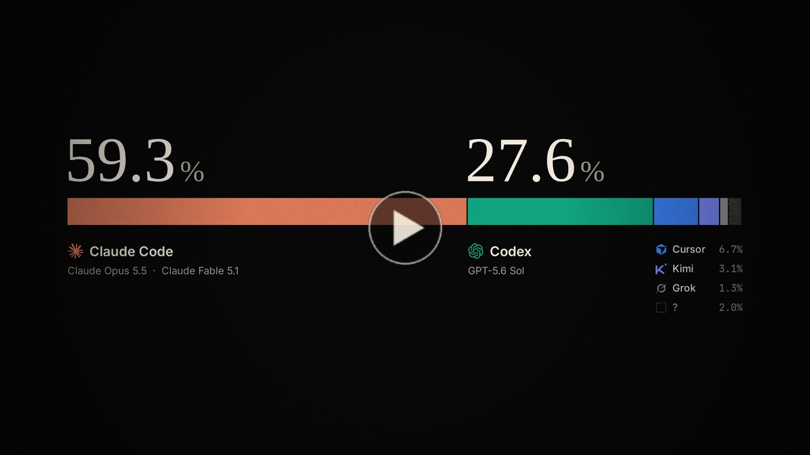
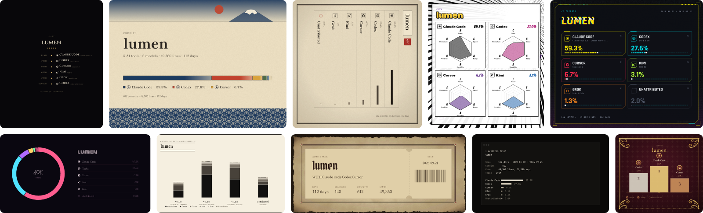
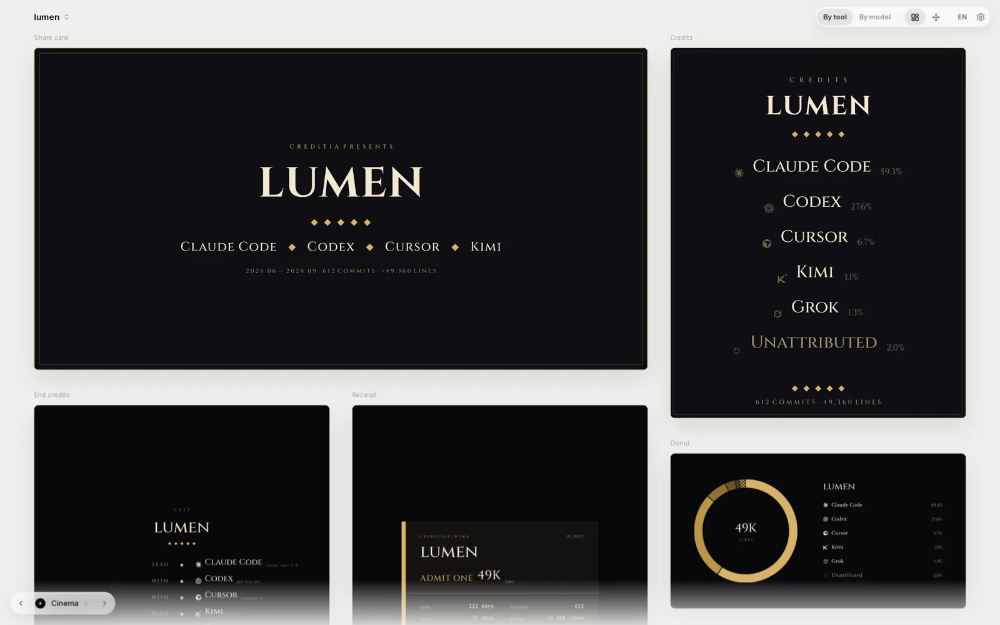

<div align="center">

<picture>
  <source media="(prefers-color-scheme: dark)" srcset=".github/readme/logo-dark.svg">
  
</picture>

# creditia

**Which AI wrote your code.**

Reads your local git history and agent logs, matches every line to the tool and model that wrote it,<br>
and turns the result into badges, CREDITS.md, end credits and share cards. Runs locally, calls no model.

[](https://wroughtmind.github.io/creditia/self/en/)

[Website](https://wroughtmind.github.io/creditia/) · [Install](#install) · [Attribution rules](ATTRIBUTION.en.md) · [中文](README.md)

<a href="https://wroughtmind.github.io/creditia/promo.mp4"></a>

</div>

<br>

<picture>
  <source media="(prefers-color-scheme: dark)" srcset=".github/readme/map-dark-en.svg">
  
</picture>

## One command

```text
$ creditia analyze && creditia fetch
catnap  2026-05-11 → 2026-09-28
────────────────────────────────
Claude Code     ████████████░░░░░░░░░░░░░  48.3%  Claude Opus 5.5
Codex           ███████░░░░░░░░░░░░░░░░░░  29.2%  GPT-5.6 Sol
Cursor          ██░░░░░░░░░░░░░░░░░░░░░░░   8.6%  Composer 2
Kimi            █░░░░░░░░░░░░░░░░░░░░░░░░   4.4%  Kimi K3
Grok            █░░░░░░░░░░░░░░░░░░░░░░░░   2.0%  Grok 5 Code
Mara Okafor     █░░░░░░░░░░░░░░░░░░░░░░░░   0.8%
Unattributed    ██░░░░░░░░░░░░░░░░░░░░░░░   6.8%

commits 734  lines 50,190  tokens 448M
```

Once analyzed, put the result to use:

```bash
creditia doc                                  # write CREDITS.md (only its marked block)
creditia export --piece roll --out roll.png   # end credits
creditia export --list                        # every piece, layout, style and format
creditia hook install                         # stamp future commits, so they count even after logs are gone
creditia release install                      # release credits: credits in release notes and PR comments
creditia schedule install                     # every hour, collect new records into the library, so evidence outlives the tools' log cleanup
creditia blame src/core/analyze.ts:12         # which tool and model wrote this line
creditia doc --by contributor                 # team repos: one row per committer, with what each tool wrote of their commits
```

One project in several places (worktrees, scratch clones, another machine): `creditia paths` lists the registered paths, `creditia link <path>` adds one.

**Code written on another computer or in the cloud** — Analysis reads only this computer's logs, so code written elsewhere is "unattributed" here (analysis tells you how many commits look like that). Two ways to fill it in:

- Install creditia there too and turn on commit stamps: each commit then carries how many lines each tool wrote according to that computer's logs (`Creditia-Lines`), which any machine's analysis accepts. For cloud environments (Codex cloud's setup script, Codespaces' `postCreateCommand`, Claude Code on the web's environment setup…), add two lines to the startup script (this sample hasn't been tested in a real cloud session yet):

  ```bash
  cargo install --git https://github.com/WroughtMind/creditia creditia-cli
  creditia-core hook install --repo .
  ```

- Run `creditia evidence export --out ev.json` on that computer, bring the file over, `creditia evidence import ev.json`, and analyze again.

Pieces list one row per tool by default; `--group model` gives one row per model (also in the App's top bar, remembered per project). When one tool used several models, its model rows sit next to each other in shades of the same brand color. Each kind of piece also has a layout that draws every tool with its models underneath: "split" and "grouped" bars, the "nested" donut, the "troupe" credits roll, the "itemized" receipt, "blocks" waffle, "split" badge and the "with models" byline (marked with a small dot in the App).

Commit stamps and release credits both change your repository, so they are your call, per project: `init` / `analyze` ask once in a terminal (the answer goes into `.creditia/config.json` and isn't asked again), and the App shows both switches in each project's Project Settings (the “…” on its row in the project menu, or ⌘I), ready to flip back any time. `creditia integrations` shows where they stand.

## Every line has a source

- **Matched in logs** — The tool's own log recorded writing this line: Claude Code Write / Edit, Codex FileChange, Cursor line hashes…
- **Declared in commits** — Commit email, `Co-authored-by`, `Assisted-by`, creditia's commit stamp
- **Inferred** — When most of a contiguous change has line-level evidence from one tool, the rest of that change follows it; branches tools create themselves, like `codex/`. Kept separate; turn off with `--level strict`
- **Unattributed** — Anything that matches none of the above. Counted toward no tool

Percentages are taken over every added line: AI tools, other contributors (other people's commits in a team repo, shown by git name unless you turn names off) and unattributed lines add up to 100%. Lines in your own commits with no AI evidence are unattributed, not counted as hand-written. Full rules and known limits: [ATTRIBUTION.en.md](ATTRIBUTION.en.md).

## Twenty-six looks



One record, more than twenty pieces (leaderboard, share card, end credits, code map, evidence, areas, receipt, badge, timeline ribbon, activity clock…) × twenty-six styles, out as PNG, SVG, PDF, GIF or HTML. Each style is a full visual language, not a palette swap, and some pieces get their own layouts in some styles: vertical woodblock print, manga stat panels, a cyber HUD, a dozen ways to roll end credits.

> Minimal · Minimal Dark · Glass · Film · Cinema · Editorial · Broadsheet · Playbill · Gala · Mono · Poster · Terminal · CRT · Neon · Arcade<br>
> Ink Wash · Ukiyo-e · Woodblock Book · Baroque · Grimoire · Manuscript · Symmetry · Cut-Paper Titles · Summer Meadow · Manga · Cyber

See them all side by side on the [website's style wall](https://wroughtmind.github.io/creditia/#looks).

## Four ways to use it

**Command line** — everything above. Every command takes `--json`.

**Your agent** — install [skills/creditia](skills/creditia/SKILL.md) into your agent and ask it which AIs wrote this repo. It analyzes and renders step by step, and asks you before publishing or committing anything.

**Cross-project summary** — with several projects in the library, the App's project menu gets an "All projects" entry at the top: their credits merged into one, and the whole wall draws as usual. On the command line it's `creditia summary` (prints a card; `--out all.json` writes a credits file), or add `--all-projects` to any command, e.g. `creditia export --all-projects --piece tier`. Line counts add up; versions belong to each project and aren't merged; files and PRs carry their project's name.

**Privacy check before publishing** — before `creditia publish` writes credits.json, it lists every kind of thing that becomes public (PR / commit titles, file paths, people's names, working hours, repository URLs) with a few examples, and flags anything that looks private (secret-like strings, emails, local paths, internal hosts, URLs with credentials). In a terminal it asks per category, and a category with something suspicious defaults to private. `--check` only checks, `--hide titles,paths` and the like hide directly; in scripts it refuses to write when something looks private unless you add `--yes`. Hiding only changes the published copy, never your local record.

**GitHub Action** — CI can't see anyone's agent logs, so analysis runs locally: `creditia publish` writes the record to `credits.json` at the repo root; commit it. On every push the Action redraws the credits page from it, and can also write a badge (`badge:`), an asterisk (`asterisk:`, each tool's share grown into a *) and CREDITS.md (`doc:`). It can put each release's credits into its release notes (`release-notes: true`) and comment a PR's credits on it, updated on every push (`pr-comment: true`); `creditia release install` writes that workflow for you. Those two don't need credits.json: with commit stamps on, every commit carries a `Creditia-Lines` trailer (lines per tool, computed locally at commit time, no code), and that's all CI reads.

**Dynamic badge** — the credits site (`site:`) always includes a `badge.json`. Publish it to GitHub Pages and put `` in your README; the badge follows every push. On its own: `creditia badge-json --out badge.json`, or `badge-json:` in the Action. Without credits.json it sums the stamps on all commits.

```yaml
# .github/workflows/credits.yml
on: { push: { branches: [main] } }
permissions: { contents: read, pages: write, id-token: write }
jobs:
  credits:
    runs-on: ubuntu-latest
    environment: github-pages
    steps:
      - uses: actions/checkout@v4
      - uses: WroughtMind/creditia@main
        with: { site: _site, style: ink, lang: en }
      - uses: actions/upload-pages-artifact@v3
        with: { path: _site }
      - uses: actions/deploy-pages@v4
```

**App** — one wall: switch projects at the top, styles with the dots at the bottom left, and every piece is laid out at once. Hover a piece to change its layout or export it, hover any part of it for details, or drag it onto the export dock. [Try it on the website](https://wroughtmind.github.io/creditia/#use).

<picture>
  <source media="(prefers-color-scheme: dark)" srcset="site/app-dark-en.webp">
  
</picture>

## Supported tools

The development build registers **78 agent entries**, all available for commit attribution, launch identity and skill installation guidance. **72 entries have history readers** (including limited edits, metadata, imports and conditional formats), 5 attribute through the actual executing host, and CodeMaker's native edit format remains unconfirmed. Real Lingma history, Eve's local source sandbox and inference.sh's Codex driver have passed their respective acceptance checks. MCPJam's official local launch chain and real executors passed scripted-model checks; account and cloud modes remain separate. See [native acceptance](SUPPORT_NATIVE_LIVE.md), [MCPJam acceptance](SUPPORT_MCPJAM_LIVE.md) and [remaining work](https://github.com/WroughtMind/creditia/issues/110). These counts do not mean every version or account has passed runtime validation.

Run `creditia agents --json` for the catalogue. The [complete matrix](AGENT_SUPPORT.en.md) lists all 78 entries; [reader boundaries](ADAPTERS.md) explain which edits can be attributed. CLI and App share the same readers. Missing models remain unknown; commit declarations remain distinct from line evidence.

| | Tool | What it reads | Lines | Model |
|:-:|---|---|:-:|:-:|
|  | Claude Code | Write / Edit / MultiEdit in `~/.claude/projects/*/*.jsonl`; providers incl. Bedrock, Vertex, relays | ✓ | ✓ |
|  | Codex | `~/.codex` thread store + rollout FileChange; provider from `model_provider` | ✓ | ✓ |
|  | Cursor | `ai-code-tracking.db` line hashes, byte-for-byte the same as Cursor's own | ✓ | ✓ |
|   | Gemini CLI · Qwen Code | Successful write / replace in `~/.gemini/tmp/<project>/chats` (`.json` and the newer `.jsonl`); newer Qwen Code's `~/.qwen/projects/*/chats/*.jsonl` | ✓ | ✓ |
|  | OpenCode | Completed edit / write / patch in `opencode.db` (the SQLite store of newer versions, both its v1 and v2 tables) and the older `storage/*.json`; provider from `providerID` | ✓ | ✓ |
|    | Cline · Roo Code · Kilo Code | `tasks/*/ui_messages.json` in each VS Code–family editor; the Kilo CLI's `kilo.db` (a fork of OpenCode) | ✓ | ✓ |
|   | Grok · Kimi | File-write calls in their session directories | ✓ | ✓ |
|  | GitHub Copilot | Successful edits in VS Code `chatSessions` and agent transcripts; Copilot CLI `~/.copilot/session-state` | ✓ | ✓ |
|  | Aider | The repo's `.aider.chat.history.md`: only files confirmed by "Applied edit", timed by its commit | ✓ | ✓ |
| | Amp · TRAE CLI | Completed edits in Amp's local `threads/*.json`; TRAE CLI session rollouts | ✓ | ✓ |
| | Goose | `~/.local/share/goose/sessions/sessions.db`: successful write / edit / text_editor calls (paired with their tool results) and shell commands; model from the per-call usage ledger | ✓ | ✓ |
| | Amazon Q CLI | The conversations table in `amazon-q/data.sqlite3`: fs_write calls and commands whose result is Success; only the latest conversation per directory is kept | ✓ | ✓ |
| | Antigravity CLI | `agy`'s `~/.gemini/antigravity-cli/brain/*/…/transcript_full.jsonl`: write_to_file / replace_file_content calls and commands whose result is DONE (closed source; read from third-party observation) | ✓ | ✓ |
| | Zed | The agent panel's `threads/threads.db`: successful edit_file / write_file results carry full before / after contents, and their difference counts; terminal commands | ✓ | ✓ |
| | Continue | `~/.continue/sessions/*.json` (shared by the editor extensions and the `cn` CLI): edits and commands with status done; rejected diffs don't count | ✓ | ✓ |
| | Crush | The project's `.crush/crush.db`: lines added between consecutive file versions in the `files` table; `Assisted-by: Crush:<model>` in commits | ✓ | ✓ |
|   | Copilot cloud · Devin · Jules · Cursor cloud · bots | Commit email, `Co-authored-by`, `Assisted-by`, author name | declared | — |
| | Any tool | `creditia stamp` / commit-hook stamp (`Creditia-Harness` trailer) | declared | ✓ |

## Install

The CLI is currently available from source. The npm package and app installers are not published yet; official installation channels will be announced on the [website](https://wroughtmind.github.io/creditia/) and [Releases](https://github.com/WroughtMind/creditia/releases).

Source installation requires Git, Rust and Node 22.18+:

```bash
git clone https://github.com/WroughtMind/creditia
cd creditia
cargo build --release -p creditia-cli
npm ci --prefix packages/render
cd packages/cli
npm ci
npm run build
npm link
```

After installation, run `creditia --help` for commands and `creditia export --list` for the available artwork.

To install only the analysis core, use the command below. Its executable is named `creditia-core` and does not include artwork export:

```bash
cargo install --git https://github.com/WroughtMind/creditia creditia-cli
```

App installers are in preparation. macOS builds use ad-hoc signing, without Apple Developer ID signing or notarization. Once released, verify the download source and SHA-256 first. For an unidentified-developer warning, try opening the app once, then use System Settings → Privacy & Security → Open Anyway. If macOS reports damage, check or download the file again; do not assume every warning is caused by notarization. Do not disable Gatekeeper globally.

See the [release procedure](packaging/RELEASE.md) for packaging and acceptance checks.

Agent skill (use `creditia agents` to find an agent ID; this example uses Claude Code):

```bash
npx skills add WroughtMind/creditia --skill creditia -a claude-code
```

For the local development version, replace `WroughtMind/creditia` with this checkout's path. Select another catalogue ID for other agents. Installing a skill does not enable native history reading.

The GitHub Action needs no install: use `WroughtMind/creditia@main`.

The command line speaks Chinese by default; add `--lang en` or set `CREDITIA_LANG=en` for English.

Days, weeks and the punch card use each commit author's local time; session times and the generation time use the most common timezone in your own commits (not the machine's, so CI gives the same result). To force one timezone, set `CREDITIA_TZ=+08:00` (or `UTC`).

The first analysis of a large repository traces every current line back to its commit, which takes a while: a repo with 12,000 commits and 9,000 files takes tens of minutes on a single core, much less on more. The terminal and the app show which step it is on; cancel midway and the next run picks up where it stopped. After that, only new commits are analyzed.

<details>
<summary><b>Repository layout</b></summary>

```
crates/
  core/       attribution engine, line hashing, model catalog (name normalization, vendors, providers), config
  adapters/   readers for git and each agent's logs
  store/      library: projects, paths, evidence store, snapshots (SQLite)
  cli/        the creditia-core binary
packages/
  schema/     JSON Schema and types for credits.json v0
  render/     rendering: credits.json → SVG scene (style × piece) → PNG / SVG / PDF / GIF / HTML
  cli/        the creditia npm package: records, export, terminal card
  embed/      <creditia-card> web component
apps/desktop/ Tauri 2 app (wall and export)
site/         website (build.ts) and the images in this README (readme.ts)
skills/       skill for agents
spike/        phase-0 validation project (kept for the record)
```

</details>

<details>
<summary><b>Development</b></summary>

```bash
cargo build --release && cargo test           # Rust core (end-to-end tests use fake logs in a temp HOME)
cd packages/render && npm i && npm test       # rendering (every piece × style × layout)
npm run gallery                               # proof sheet: gallery/index.html
cd apps/desktop && npm i && npm run fonts && npm run dev   # app in the browser (uses the fixture record)
npm run core && npm run tauri dev             # native app (core puts the analysis binary where the app bundles it)
node site/build.ts                            # website → _site/
node site/readme.ts                           # README images → .github/readme/
```


</details>

## License

MIT, see [LICENSE](LICENSE). Logos come from simple-icons (CC0) and are used only to identify each tool.
