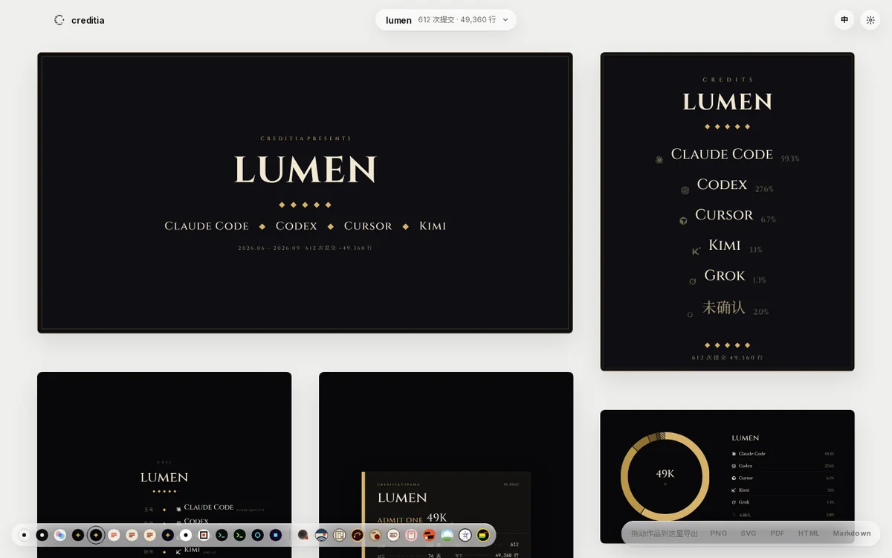

<div align="center">

<picture>
  <source media="(prefers-color-scheme: dark)" srcset=".github/readme/logo-dark.svg">
  
</picture>

# creditia

**Which AI wrote your code.**

Reads your local git history and agent logs, matches every line to the tool and model that wrote it,<br>
and turns the result into badges, CREDITS.md, end credits and share cards. Runs locally, calls no model.

[](https://wroughtmind.github.io/creditia/self/en/)

[Website](https://wroughtmind.github.io/creditia/) · [Install](#install) · [Attribution rules](ATTRIBUTION.en.md) · [中文](README.md)

</div>

<br>

<picture>
  <source media="(prefers-color-scheme: dark)" srcset=".github/readme/map-dark-en.svg">
  
</picture>

## One command

```text
$ creditia analyze && creditia fetch
lumen  2026-06-02 → 2026-09-21
───────────────────────────────
Claude Code     ███████████████░░░░░░░░░░  59.3%  Claude Opus 5.5
Codex           ███████░░░░░░░░░░░░░░░░░░  27.6%  GPT-5.6 Sol
Cursor          ██░░░░░░░░░░░░░░░░░░░░░░░   6.7%  Composer 2
Kimi            █░░░░░░░░░░░░░░░░░░░░░░░░   3.1%  Kimi K3
Grok            █░░░░░░░░░░░░░░░░░░░░░░░░   1.3%  Grok 5 Code
Unattributed    █░░░░░░░░░░░░░░░░░░░░░░░░   2.0%

commits 612  lines 49,360  tokens 491M
```

Once analyzed, put the result to use:

```bash
creditia doc                                  # write CREDITS.md (only its marked block)
creditia export --piece roll --out roll.png   # end credits
creditia export --list                        # every piece, layout, style and format
creditia hook install                         # stamp future commits, so they count even after logs are gone
creditia blame src/core/analyze.ts:12         # which tool and model wrote this line
```

One project in several places (worktrees, scratch clones, another machine): `creditia paths` lists the registered paths, `creditia link <path>` adds one.

## Every line has a source

- **Matched in logs** — The tool's own log recorded writing this line: Claude Code Write / Edit, Codex FileChange, Cursor line hashes…
- **Declared in commits** — Commit email, `Co-authored-by`, creditia's commit stamp
- **Inferred** — When most of a contiguous change has line-level evidence from one tool, the rest of that change follows it; branches tools create themselves, like `codex/`. Kept separate; turn off with `--level strict`
- **Unattributed** — Anything that matches none of the above. Counted toward no tool

creditia answers one question — which AI tools and models wrote how much. No names appear in any piece, and percentages are taken over AI and unattributed lines only. Full rules and known limits: [ATTRIBUTION.en.md](ATTRIBUTION.en.md).

## Twenty-six looks


One record, more than twenty pieces (leaderboard, share card, end credits, code map, evidence, areas, receipt, badge, timeline ribbon, activity clock…) × twenty-six styles, out as PNG, SVG, PDF, GIF or HTML. Each style is a full visual language, not a palette swap, and some pieces get their own layouts in some styles: vertical woodblock print, manga stat panels, a cyber HUD, a dozen ways to roll end credits.

> Minimal · Minimal Dark · Glass · Film · Cinema · Editorial · Broadsheet · Playbill · Gala · Mono · Poster · Terminal · CRT · Neon · Arcade<br>
> Ink Wash · Ukiyo-e · Woodblock Book · Baroque · Grimoire · Manuscript · Symmetry · Cut-Paper Titles · Summer Meadow · Manga · Cyber

See them all side by side on the [website's style wall](https://wroughtmind.github.io/creditia/#looks).

## Four ways to use it

**Command line** — everything above. Every command takes `--json`.

**Your agent** — install [skills/creditia](skills/creditia/SKILL.md) into your agent and ask it which AIs wrote this repo. It analyzes and renders step by step, and asks you before publishing or committing anything.

**GitHub Action** — CI can't see anyone's agent logs, so analysis runs locally: `creditia publish` writes the record to `credits.json` at the repo root; commit it. On every push the Action redraws the credits page from it, and can also write a badge (`badge:`) and CREDITS.md (`doc:`).

```yaml
# .github/workflows/credits.yml
on: { push: { branches: [main] } }
permissions: { contents: read, pages: write, id-token: write }
jobs:
  credits:
    runs-on: ubuntu-latest
    environment: github-pages
    steps:
      - uses: actions/checkout@v4
      - uses: WroughtMind/creditia@main
        with: { site: _site, style: ink, lang: en }
      - uses: actions/upload-pages-artifact@v3
        with: { path: _site }
      - uses: actions/deploy-pages@v4
```

**App** — one wall: switch projects at the top, styles with the dots at the bottom left, and every piece is laid out at once. Hover a piece to change its layout or export it, hover any part of it for details, or drag it onto the export dock. [Try it on the website](https://wroughtmind.github.io/creditia/#use).

<picture>
  <source media="(prefers-color-scheme: dark)" srcset="site/app-dark.webp">
  
</picture>

## Supported tools

| | Tool | What it reads | Lines | Model |
|:-:|---|---|:-:|:-:|
|  | Claude Code | Write / Edit / MultiEdit in `~/.claude/projects/*/*.jsonl`; providers incl. Bedrock, Vertex, relays | ✓ | ✓ |
|  | Codex | `~/.codex` thread store + rollout FileChange; provider from `model_provider` | ✓ | ✓ |
|  | Cursor | `ai-code-tracking.db` line hashes, byte-for-byte the same as Cursor's own | ✓ | ✓ |
|   | Gemini CLI · Qwen Code | Successful write / replace in `~/.gemini/tmp/<project hash>/chats` | ✓ | ✓ |
|  | OpenCode | Completed edit / write in `storage/session + message + part`; provider from `providerID` | ✓ | ✓ |
|    | Cline · Roo Code · Kilo Code | `tasks/*/ui_messages.json` in each VS Code–family editor | ✓ | ✓ |
|   | Grok · Kimi | File-write calls in their session directories | ✓ | ✓ |
|  | GitHub Copilot | Successful edits in VS Code `chatSessions` and agent transcripts; Copilot CLI `~/.copilot/session-state` | ✓ | ✓ |
|  | Aider | The repo's `.aider.chat.history.md`: only files confirmed by "Applied edit", timed by its commit | ✓ | ✓ |
| | Amp · TRAE CLI | Completed edits in Amp's local `threads/*.json`; TRAE CLI session rollouts | ✓ | ✓ |
|   | Copilot cloud · Devin · Jules · Cursor cloud · bots | Commit email, `Co-authored-by`, author name | declared | — |
| | Any tool | `creditia stamp` / commit-hook stamp (`Creditia-Harness` trailer) | declared | ✓ |

## Install

Needs Node 22+. npm, Homebrew, one-line scripts and app installers are coming soon; for now, install from source:

```bash
git clone https://github.com/WroughtMind/creditia && cd creditia/packages/cli && npm i && npm link
# or just the Rust analysis core
cargo install --git https://github.com/WroughtMind/creditia creditia-cli
```

Agent skill (Claude Code):

```bash
git clone --depth 1 https://github.com/WroughtMind/creditia /tmp/creditia && cp -r /tmp/creditia/skills/creditia ~/.claude/skills/
```

The GitHub Action needs no install: use `WroughtMind/creditia@main`.

The command line speaks Chinese by default; add `--lang en` or set `CREDITIA_LANG=en` for English.

The first analysis of a large repository traces every current line back to its commit, which takes a while: a repo with 12,000 commits and 9,000 files takes tens of minutes on a single core, much less on more. The terminal and the app show which step it is on; cancel midway and the next run picks up where it stopped. After that, only new commits are analyzed.

<details>
<summary><b>Repository layout</b></summary>

```
crates/
  core/       attribution engine, line hashing, model catalog (name normalization, vendors, providers), config
  adapters/   readers for git and each agent's logs
  store/      library: projects, paths, evidence store, snapshots (SQLite)
  cli/        the creditia-core binary
packages/
  schema/     JSON Schema and types for credits.json v0
  render/     rendering: credits.json → SVG scene (style × piece) → PNG / SVG / PDF / GIF / HTML
  cli/        the creditia npm package: records, export, terminal card
  embed/      <creditia-card> web component
apps/desktop/ Tauri 2 app (wall and export)
site/         website (build.ts) and the images in this README (readme.ts)
skills/       skill for agents
spike/        phase-0 validation project (kept for the record)
```

</details>

<details>
<summary><b>Development</b></summary>

```bash
cargo build --release && cargo test           # Rust core (end-to-end tests use fake logs in a temp HOME)
cd packages/render && npm i && npm test       # rendering (every piece × style × layout)
npm run gallery                               # proof sheet: gallery/index.html
cd apps/desktop && npm i && npm run fonts && npm run dev   # app in the browser (uses the fixture record)
npm run core && npm run tauri dev             # native app (core puts the analysis binary where the app bundles it)
node site/build.ts                            # website → _site/
node site/readme.ts                           # README images → .github/readme/
```

The macOS app isn't signed yet: the first time you open a build, right-click → Open, or run `xattr -cr /Applications/creditia.app`.

</details>

## License

MIT, see [LICENSE](LICENSE). Logos come from simple-icons (CC0) and are used only to identify each tool.
