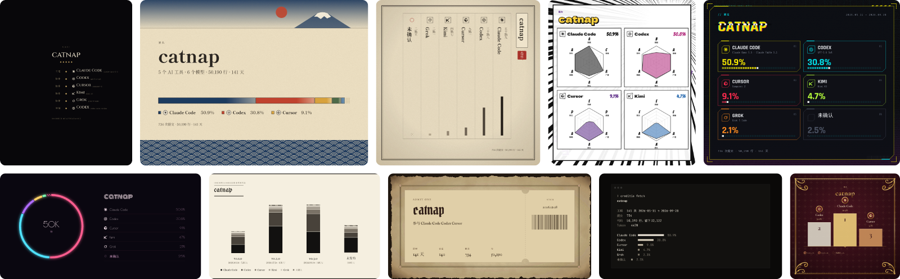

<div align="center">

<picture>
  <source media="(prefers-color-scheme: dark)" srcset=".github/readme/logo-dark.svg">
  
</picture>

# creditia

**你的代码，是哪些 AI 写的。**

读本机的 git 历史和 agent 日志，把每一行对上写它的工具和模型，<br>
再做成徽章、CREDITS.md、片尾字幕和分享图。全程本地，不调用任何模型。

[](https://wroughtmind.github.io/creditia/self/)

[官网](https://wroughtmind.github.io/creditia/) · [安装](#安装) · [归因规则](ATTRIBUTION.md) · [English](README.en.md)

</div>

<br>

<picture>
  <source media="(prefers-color-scheme: dark)" srcset=".github/readme/map-dark.svg">
  
</picture>

## 一行命令

```text
$ creditia analyze && creditia fetch
lumen  2026-06-02 → 2026-09-21
───────────────────────────────
Claude Code     ███████████████░░░░░░░░░░  59.3%  Claude Opus 5.5
Codex           ███████░░░░░░░░░░░░░░░░░░  27.6%  GPT-5.6 Sol
Cursor          ██░░░░░░░░░░░░░░░░░░░░░░░   6.7%  Composer 2
Kimi            █░░░░░░░░░░░░░░░░░░░░░░░░   3.1%  Kimi K3
Grok            █░░░░░░░░░░░░░░░░░░░░░░░░   1.3%  Grok 5 Code
未确认          █░░░░░░░░░░░░░░░░░░░░░░░░   2.0%

提交 612  行 49,360  token 491M
```

分析完，结果可以拿去用：

```bash
creditia doc                                  # 写 CREDITS.md（只改标记区间）
creditia export --piece roll --out roll.png   # 片尾字幕
creditia export --list                        # 全部作品、版式、风格、格式
creditia hook install                         # 以后每次提交自动盖章：日志被清理了也认得出
creditia blame src/core/analyze.ts:12         # 这一行是哪个工具、哪个模型写的
```

一个项目在好几个地方（worktree、临时克隆、换过电脑）：`creditia paths` 看登记过的路径，`creditia link <路径>` 补上。

## 每一行，都有出处

- **日志里对得上**　工具日志里有这一行的写入：Claude Code 的 Write / Edit、Codex 的 FileChange、Cursor 的逐行哈希……
- **提交里写明了**　提交邮箱、`Co-authored-by`、creditia 的提交盖章
- **推断**　同一段改动里大半有某个工具的逐行证据，其余的行跟着它走；`codex/` 这类工具自动建的分支。单独记，`--level strict` 关掉
- **未确认**　以上都对不上的行。不算给任何工具

creditia 只回答「哪些 AI 工具和模型写了多少」：作品里不出现任何名字，百分比只在 AI 和「未确认」的行之间算。完整规则和已知的边界在 [ATTRIBUTION.md](ATTRIBUTION.md)。

## 二十六种样子



同一份档案，二十多种作品（署名榜、分享图、片尾字幕、代码地图、出处、板块、小票、徽章、时间织带、作息图……）× 二十六个风格，出 PNG、SVG、PDF、GIF、HTML。每个风格是一整套视觉语言，不是换色；有的作品在某些风格下有专属版式：古籍的竖排、漫画的能力面板、赛博的 HUD、片尾字幕的十几种排法。

> 极简 · 极简暗 · 玻璃 · 胶片 · 影院 · 杂志 · 报纸 · 节目单 · 颁奖礼 · 单色 · 海报 · 终端 · 磷光屏 · 霓虹 · 街机<br>
> 水墨 · 浮世绘 · 古籍 · 巴洛克 · 魔典 · 手稿 · 对称 · 剪纸 · 夏日 · 漫画 · 赛博

全部摆在一起看：[官网的风格墙](https://wroughtmind.github.io/creditia/#looks)。

## 四种用法

**命令行**　就是上面那些。所有命令都支持 `--json`。

**交给 agent**　把 [skills/creditia](skills/creditia/SKILL.md) 装进你的 agent，跟它说「看看这个仓库是哪些 AI 写的」。它会按步骤分析、出图，公开或提交任何东西之前先问你。

**GitHub Action**　CI 里看不到任何 agent 的日志，所以分析在本机做：`creditia publish` 把档案写到仓库根目录的 `credits.json`，提交上去；之后每次推送，Action 用它重画署名页，也可以顺带生成徽章（`badge:`）和 CREDITS.md（`doc:`）。

```yaml
# .github/workflows/credits.yml
on: { push: { branches: [main] } }
permissions: { contents: read, pages: write, id-token: write }
jobs:
  credits:
    runs-on: ubuntu-latest
    environment: github-pages
    steps:
      - uses: actions/checkout@v4
      - uses: WroughtMind/creditia@main
        with: { site: _site, style: ink }
      - uses: actions/upload-pages-artifact@v3
        with: { path: _site }
      - uses: actions/deploy-pages@v4
```

**App**　一面展墙：顶部切换项目，左下角的圆点切换风格，所有作品直接摆出来。悬停作品换版式、选格式导出，作品里的每一块都能悬停看细节；把作品拖到右下角的导出坞也能导出。[在官网上直接试](https://wroughtmind.github.io/creditia/#use)。

<picture>
  <source media="(prefers-color-scheme: dark)" srcset="site/app-dark.webp">
  
</picture>

## 支持的工具

| | 工具 | 读什么 | 逐行 | 模型 |
|:-:|---|---|:-:|:-:|
|  | Claude Code | `~/.claude/projects/*/*.jsonl` 的 Write / Edit / MultiEdit；渠道含 Bedrock、Vertex、中转站 | ✓ | ✓ |
|  | Codex | `~/.codex` 线程库 + rollout 的 FileChange；渠道看 `model_provider` | ✓ | ✓ |
|  | Cursor | `ai-code-tracking.db` 逐行哈希，与 Cursor 自己的算法逐字节一致 | ✓ | ✓ |
|   | Gemini CLI · Qwen Code | `~/.gemini/tmp/<项目哈希>/chats` 里成功的 write / replace | ✓ | ✓ |
|  | OpenCode | `storage/session + message + part` 里 completed 的 edit / write；渠道看 `providerID` | ✓ | ✓ |
|    | Cline · Roo Code · Kilo Code | 各 VS Code 系编辑器里的 `tasks/*/ui_messages.json` | ✓ | ✓ |
|   | Grok · Kimi | 会话目录里的写文件调用 | ✓ | ✓ |
|  | GitHub Copilot | VS Code 的 `chatSessions` 与 agent 记录里成功的编辑；Copilot 命令行的 `~/.copilot/session-state` | ✓ | ✓ |
|  | Aider | 仓库里的 `.aider.chat.history.md`：只算「Applied edit」确认过的文件，时间取它的提交 | ✓ | ✓ |
| | Amp · TRAE 命令行 | Amp 本地的 `threads/*.json`（完成的编辑）；TRAE CLI 的会话 rollout | ✓ | ✓ |
|   | Copilot 云端 · Devin · Jules · Cursor 云端 · bot | 提交邮箱、`Co-authored-by`、作者名 | 声明 | — |
| | 任何工具 | `creditia stamp` / 提交 hook 盖章（`Creditia-Harness` trailer） | 声明 | ✓ |

## 安装

需要 Node 22+。npm、Homebrew、一行脚本和 App 安装包即将推出，现在从源码装：

```bash
git clone https://github.com/WroughtMind/creditia && cd creditia/packages/cli && npm i && npm link
# 或者只要 Rust 分析核心
cargo install --git https://github.com/WroughtMind/creditia creditia-cli
```

Agent skill（Claude Code）：

```bash
git clone --depth 1 https://github.com/WroughtMind/creditia /tmp/creditia && cp -r /tmp/creditia/skills/creditia ~/.claude/skills/
```

GitHub Action 直接用 `WroughtMind/creditia@main`，不用装。

命令行默认说中文；加 `--lang en` 或设 `CREDITIA_LANG=en` 改说英文。

大仓库第一次分析要逐个文件追溯现在的每一行，比较慢：一万多个提交、九千个文件的仓库，单核机器上要几十分钟，多核快得多。终端和 App 里都能看到走到哪一步；中途取消，下次接着跑；之后每次只算新提交。

<details>
<summary><b>仓库结构</b></summary>

```
crates/
  core/       归因引擎、行哈希、模型目录（名称归一、厂商、渠道）、配置
  adapters/   git 与各家 agent 日志的读取
  store/      作品库：项目、路径、证据库、快照（SQLite）
  cli/        二进制 creditia-core
packages/
  schema/     credits.json v0 的 JSON Schema 与类型
  render/     作品渲染：credits.json → SVG 场景（风格 × 作品）→ PNG / SVG / PDF / GIF / HTML
  cli/        npm 包 creditia：档案、导出、终端名片
  embed/      <creditia-card> 网页组件
apps/desktop/ Tauri 2 App（展墙与导出）
site/         官网（build.ts）和这份 README 的图（readme.ts）
skills/       给 agent 用的 skill
spike/        阶段 0 验证工程（保留作记录）
```

</details>

<details>
<summary><b>开发</b></summary>

```bash
cargo build --release && cargo test           # Rust 核心（端到端测试用临时 HOME 里的假日志）
cd packages/render && npm i && npm test       # 渲染（全部作品 × 全部风格 × 全部版式）
npm run gallery                               # 样张：gallery/index.html
cd apps/desktop && npm i && npm run fonts && npm run dev   # 浏览器里调 App（用 fixtures 里的样例档案）
npm run core && npm run tauri dev             # 原生 App（core 把分析核心放进 App 的打包位置）
node site/build.ts                            # 官网 → _site/
node site/readme.ts                           # README 的图 → .github/readme/
```

macOS 的 App 目前没有签名：自己打包的第一次打开时右键 → 打开，或者运行 `xattr -cr /Applications/creditia.app`。

</details>

## 协议

MIT，见 [LICENSE](LICENSE)。logo 来自 simple-icons（CC0），仅用于识别对应工具。
