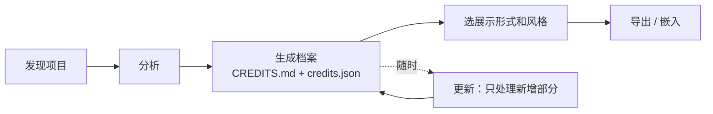

# creditia 完整计划

> 为你和 AI 一起做出的作品署名。
> Credits for work made with agents.

状态：最终版 v4，待开工 · 2026-10-08
发布位置：GitHub 组织 WroughtMind，魏碑之后的第二个产品

配套文档：

| 文档 | 内容 |
|---|---|
| [`2026-10-08-creditia-forms.md`](2026-10-08-creditia-forms.md) | 全部展示形式和统计图的清单 |
| [`2026-10-08-creditia-scenarios.md`](2026-10-08-creditia-scenarios.md) | 各种情况的处理方案 |
| [`2026-10-08-creditia-validation.md`](2026-10-08-creditia-validation.md) | 技术验证方案（阶段 0） |

---

## 1. 产品定义

### 1.1 背景

以往的软件来自人脑劳动，质量只能靠最终的市场表现间接体现。今天大量代码、设计和方案由 coding agent 完成，各家模型和 agent 各有特点、实力不同。一个作品背后凝聚了哪些人、哪些 agent、哪些模型的精力，目前没有地方可以度量，也没有地方可以展示。

起点是魏碑官网的 Credits 面板：Codex 86.6% · Cursor 6.6% · Grok 4.0% · Claude Code 0.4% · DeepSeek 0.4% · 未确认 1.6%（1,910 次提交 · 804 项 · +445,981 行）。它证明了这种展示有意义，但当时只能手工整理、靠间接信号归因。

### 1.2 creditia 是什么

对照电影：

- **片尾字幕**：给观众看，告诉大家谁做了这部片子，带着荣誉感
- **IMDb**：结构化的档案，谁在哪部片子里做了什么，都能查到

creditia 同时提供这两样：

- **展示**：tier、片尾字幕、精力小票、统计图……让看的人一眼看懂、愿意转发
- **档案**：仓库里的 `CREDITS.md` 和 `credits.json`，按版本、按 PR 结构化记录谁做了什么

### 1.3 价值

| 价值 | 说明 |
|---|---|
| 展示与情绪 | 作品集、官网、社交媒体上，体面地展示"我和哪些 AI 一起做出了这个" |
| 结构化记录 | 一个项目的 AI 协作历史被整理成档案，跟着仓库走 |
| 溯源 | 出了问题能查到某段代码是哪个模型、在哪次会话里写的 |
| 交接 | 新的 agent 或协作者接手前，先读档案了解谁做了哪部分 |
| 披露 | 有些开源项目要求说明 AI 参与情况，档案就是现成的披露材料 |

### 1.4 用户

- 第一批：高强度使用 coding agent 的独立开发者
- 以后：开发团队、开发商

## 2. 已定决策

| 项 | 决定 |
|---|---|
| 产品名 | creditia 或 Credit Machine，待定（npm 上两者都未被占用） |
| 开源协议 | MIT |
| 发布位置 | GitHub 组织 WroughtMind |
| 平台 | macOS、Windows、Linux |
| 入口 | CLI 和 agent skill 是主力；App 是轻量的查看和导出中心；另有网页 embed |
| 核心产出 | 档案（`CREDITS.md` + `credits.json`）+ 多种展示形式 + 统计图 |
| 叙事、口径 | 不预设，由用户选 |
| 模型对比 | 往后放，数据字段先保留 |
| 视觉 | App、CLI 自身有统一风格；导出物多套风格；整体轻量、现代 |
| 各工具 logo | 直接使用各家 logo 和熟悉的颜色，让看的人一眼认出 |
| creditia 自己的 logo | 独立设计，与魏碑无关，等 App 风格定稿后做 |
| 技术栈 | Tauri 2 + Rust 核心 + TypeScript 渲染器 |

## 3. 产品原则

1. **一份档案，多种展示。** 所有形式都读同一份 `credits.json`。
2. **每种形式只回答一个问题。** 不做塞满开关的看板；更细的信息放进档案，不塞进图里。
3. **一眼能懂。** 单个展示形式要像魏碑的 Credits 面板一样，几秒内看懂。
4. **轻量。** 一条命令或一句话生成全部产出；以后增量更新；接入只需一行代码。
5. **本地优先。** 扫描和计算都在本机。prompt、代码、日志原文不离开本机。
6. **诚实。** 证据不够就归入"未确认"并说明原因；口径标注在图上。
7. **人单独署名。** 人不和 agent 一起排代码行百分比，而是作为主导者单独署名在最上方。
8. **人能用的，agent 也能用。** 每个操作都有 CLI 命令，都能输出机器可读的结果。

## 4. 产品形态与使用流程

### 4.1 三个入口

| 入口 | 定位 | 用法 |
|---|---|---|
| CLI | 主力 | 在仓库里运行几条命令，生成档案和各种展示 |
| Agent skill | 主力 | 对 agent 说一句话，agent 调用 CLI 完成全程，需要你决定时停下来问 |
| App | 轻量中心 | 看到本机所有项目，浏览档案和统计图，挑形式、换风格、导出 |
| 网页 embed | 展示 | `<creditia-card>` 一行代码嵌进网站 |

### 4.2 流程



1. **发现**：从各 agent 日志记录的工作目录和仓库地址里，自动列出"检测到有 agent 参与的项目"；也可以手动添加
2. **分析**：读取 git 和 agent 日志，逐行归因
3. **生成档案**：写入仓库的 `CREDITS.md` 和 `.creditia/credits.json`；本机作品库同时保存一份，带历史快照
4. **展示和导出**：选形式、选风格，复制嵌入代码或导出图片
5. **更新**：只处理上次之后的新提交和新日志，几秒完成

### 4.3 CLI 命令

```bash
creditia discover                  # 列出检测到 agent 活动的项目
creditia init                      # 在仓库里初始化 .creditia/ 配置
creditia analyze                   # 分析当前仓库，生成档案
creditia update                    # 增量更新
creditia doc                       # 生成或更新 CREDITS.md
creditia release-notes v1.0.0      # 输出某个版本的 credits 段落
creditia export --form tier --theme minimal --format embed
creditia export --form receipt --size 1080x1350 --format png
creditia fetch                     # 终端名片
creditia blame src/foo.ts:42       # 逐行溯源（阶段 2）
creditia collect                   # 只采集证据，给定时任务用
creditia hook install              # 安装提交盖章 hook
creditia stamp                     # 给当前提交盖章（agent 调用）
creditia app open --form tier      # 在 App 里打开指定视图
creditia doctor                    # 检查各数据源是否可读、格式是否认识
```

所有命令都可以非交互运行，支持 `--json` 输出；退出码区分成功、部分成功（有警告）、失败。

### 4.4 App

App 只做几件事：

- **项目**：本机检测到的项目列表，一键分析、一键更新
- **档案**：以可读的方式浏览 `CREDITS.md` 的内容，点开 PR 看证据
- **统计**：首批统计图（见第 7 节）
- **导出**：选形式、选风格、选尺寸，右侧实时预览，"复制图片 / 下载 / 复制嵌入代码 / 复制 Markdown"
- **设置**：数据源、后台采集、隐私、板块规则、身份合并

## 5. 档案

档案是 creditia 的核心资产，其他所有形式都从它生成。

### 5.1 文件

| 文件 | 位置 | 用途 |
|---|---|---|
| `CREDITS.md` | 仓库根目录 | 给人读，GitHub 上直接能看 |
| `.creditia/credits.json` | 仓库内 | 给 agent、embed、导出读取 |
| `.creditia/config.json` | 仓库内 | 板块规则、排除规则、身份合并、隐私设置 |
| 证据库 | 本机作品库目录 | 行哈希等证据，不进仓库 |

### 5.2 `CREDITS.md` 结构

```markdown
# Credits

魏碑 · 由 changfenhuang 主导 · 1,910 次提交 · 804 项 · +445,981 行

| 贡献方 | 占比 | 项 | 新增行 |
|---|---|---|---|
| Codex | 86.6% | 696 | +281,047 |
| Cursor | 6.6% | 53 | +147,716 |
| Grok | 4.0% | 32 | +5,582 |
| Claude Code | 0.4% | 3 | +2,098 |
| DeepSeek | 0.4% | 3 | +1,389 |
| 未确认 | 1.6% | 13 | +8,080 |

口径：标准 · 证据覆盖：7 月仅 git 信号，8 月起有日志 · 生成于 2026-10-08

## v1.0.0 · 2026-08-12

Codex 91% · Grok 5% · 其他 4%

- #194 阅读器帧内 WebKit IPC 与悬浮选区面板高度反馈环 — Codex（gpt-5.6-sol）· changfenhuang 审阅
- #193 布局循环崩溃交接说明（给 Fable）— Codex · 方案文档
- …

## v0.1.0 · 2026-07-16
…
```

（总览数字取自魏碑现有面板；版本段落里的占比和模型为格式示意。）

- 按版本倒序分组；没有 tag 的项目按月分组
- 每个 PR 一行：标题、主要贡献方和模型、人的参与
- 文件里有一个标记区间，creditia 只改写区间内的内容，用户在区间外手写的内容不受影响

### 5.3 `credits.json` v0

```json
{
  "$schema": "https://creditia.dev/schema/v0.json",
  "project": { "name": "魏碑", "repos": ["github.com/WroughtMind/weibei"], "range": { "from": "2026-07-03", "to": "2026-10-06" } },
  "generatedAt": "2026-10-08T12:00:00+08:00",
  "level": "standard",
  "versions": [{ "tag": "v0.1.0", "date": "2026-07-16" }, { "tag": "v1.0.0", "date": "2026-08-12" }],
  "coverage": [{ "from": "2026-07-03", "to": "2026-07-31", "best": "declared" }, { "from": "2026-08-01", "to": "2026-10-06", "best": "verified" }],
  "directors": [{ "id": "h:changfenhuang", "name": "changfenhuang" }],
  "contributors": [
    { "id": "a:codex/gpt-5.6-sol", "kind": "agent", "harness": "codex", "model": "gpt-5.6-sol", "family": "gpt", "where": "local", "roles": ["author"] },
    { "id": "a:codex/codex-auto-review", "kind": "agent", "harness": "codex", "model": "codex-auto-review", "roles": ["reviewer"] },
    { "id": "a:cursor/auto", "kind": "agent", "harness": "cursor", "model": null, "roles": ["author"] },
    { "id": "h:changfenhuang", "kind": "human", "name": "changfenhuang", "roles": ["director", "reviewer", "author"] }
  ],
  "totals": { "commits": 0, "units": 0, "linesAdded": 0, "linesSurviving": 0, "tokens": 0, "sessions": 0, "days": 0 },
  "breakdown": [
    {
      "contributor": "a:codex/gpt-5.6-sol",
      "byEvidence": { "verified": { "units": 0, "linesAdded": 0, "linesSurviving": 0 }, "declared": {}, "inferred": {} },
      "byArea": {},
      "byVersion": {}
    }
  ],
  "human": { "prompts": 0, "plans": 0, "reviews": 0, "linesRewritten": 0, "tabAssistedLines": 0 },
  "timeline": [{ "week": "2026-W27", "byContributor": {} }],
  "sessions": [{ "contributor": "a:codex/gpt-5.6-sol", "start": "…", "end": "…", "tokens": 0 }],
  "units": [
    { "id": "pr:519", "title": "connection-cards", "date": "2026-10-03", "version": null, "commits": ["…"], "areas": ["frontend", "core", "tests"], "shares": [{ "contributor": "a:codex/gpt-5.6-sol", "share": 0.71, "evidence": "verified" }], "human": { "prompts": 0, "reviews": 0 } }
  ]
}
```

- 只存聚合数字、commit hash、PR 标题；PR 标题、分支名、人名可隐藏或改别名
- `sessions` 只存起止时间和 token，供泳道图、作息打卡图、精力小票使用
- schema 版本化，公开发布

## 6. 展示形式

完整清单见 [`2026-10-08-creditia-forms.md`](2026-10-08-creditia-forms.md)。

### 6.1 全部形式

| 类别 | 形式 |
|---|---|
| 一眼看懂 | Tier 榜单、署名行、徽章、仓库预览图 |
| 有情绪、适合传播 | 片尾字幕、精力小票、时间织带、代码马赛克、个人履历卡、终端名片 |
| 融进工作流 | `CREDITS.md`、PR 评论、Release notes 段落、逐行溯源、App 内致谢页 |

### 6.2 Tier 的设计规则

Tier 是最常用的形式，规则也适用于徽章、分享图这些衍生形式：

- **最上方**：主导者（人），单独一行，例如"由 changfenhuang 主导"，不参与百分比
- **中间**：最多 6 行贡献方，按占比降序；其余合并成"其他"；每行是 logo、名称、百分比、一根条
- **最后**："未确认"始终单独一行，不藏进"其他"
- **底部**：一行总数（提交 · 项 · 新增行）和一行口径小字（可关闭）
- **悬停**：显示该贡献方的项数、行数、主要模型
- **链接**：底部链接到 `CREDITS.md`，想深究的人进档案看
- **只有两个选项**：按工具 / 按模型；范围是全部 / 某个版本

### 6.3 每种形式的要点

| 形式 | 要点 |
|---|---|
| 署名行 | 一句话："Made by changfenhuang with Codex, Cursor & Grok"，中英文可选 |
| 徽章 | SVG，"built with · Codex 87% · Cursor 7%" |
| 仓库预览图 | 1280×640 PNG，tier 的横版 |
| 片尾字幕 | 按角色署名：主导、主笔、打磨、审阅、助演……角色由数据推出，用户可改；有静态版和滚动动画版 |
| 精力小票 | 工期、提交数、会话数、token、新增行、主导者，小票排版 |
| 时间织带 | 每天一格，按当天主要贡献方上色 |
| 代码马赛克 | 每个文件一块，按存活代码的作者上色，可悬停 |
| 个人履历卡 | 跨项目统计一个人的协作情况 |
| 终端名片 | `creditia fetch`，logo + 一组数据 |
| PR 评论 | "这个 PR：Codex 71%、Cursor 24%，changfenhuang 审阅 4 轮" |
| Release notes 段落 | 本版本的 tier 文字版 + PR 列表 |
| 逐行溯源 | `creditia blame <文件>:<行号>`，显示模型、会话、时间，可跳回会话 |
| App 内致谢页 | 给原生 App 的组件或 JSON，显示为"致谢"页 |

### 6.4 导出格式

| 场景 | 格式 |
|---|---|
| 网站 | Web Component：`<script src="…/creditia.js"></script><creditia-card src="credits.json" form="tier" theme="minimal"></creditia-card>`；或静态 HTML 片段 |
| README | SVG + Markdown 片段 |
| 社交媒体 | PNG：1200×630、1080×1350、1080×1920、1080×1080 |
| 应用内 | SVG / PNG；或 JSON + 轻量渲染包 |
| 文档、发布说明 | Markdown |
| agent | JSON |
| 视频（后期） | MP4 / GIF（片尾字幕） |

## 7. 统计图

完整清单和取舍理由见 [`2026-10-08-creditia-forms.md`](2026-10-08-creditia-forms.md)。统计图放在 App 的"统计"页给作者看，也能按同一套风格导出成图片放到官网。

| 类别 | 首批 | 后续 |
|---|---|---|
| 占比 | 华夫饼图、环形图 | 旭日图、矩形树图 |
| 时间 | 堆叠面积图、泳道图、作息打卡图、版本柱状图 | 河流图、累计增长曲线 |
| 流向与沉淀 | 沉淀漏斗（token → 写出 → 提交 → 存活） | 桑基图、接力图 |
| 人的参与 | | 指挥密度曲线、修正比例 |

不做：雷达图（属于模型对比，且易误导）、箱线图、散点图、直方图（太偏分析）。

## 8. 视觉

### 8.1 产品自身（App 和 CLI）

- 界面几乎无色：黑、白、灰阶加一个强调色。成片出现的颜色只有贡献方的颜色
- 每个工具、模型有一个固定颜色，App、CLI、所有导出物一致；默认取各家熟悉的品牌色，用户可以改
- 数字用等宽数字字体；正文用系统无衬线字体，中英文都清晰
- 亮色 / 暗色跟随系统
- 动效克制：条形从零长出、切换时颜色平滑过渡
- CLI 和 App 共用配色（终端真彩色，必要时退化到 256 / 16 色）；分析结束在终端里画一张 tier；遵守 `NO_COLOR`，输出被重定向时去掉颜色和动画

### 8.2 导出风格

| 风格 | 感觉 | 适合 |
|---|---|---|
| Minimal | 克制、留白 | 官网、作品集 |
| Film Credits | 电影片尾字幕，衬线大字、居中 | 发布宣传、片尾字幕 |
| Terminal | 等宽字体、终端配色 | README、终端名片 |
| Glass | 半透明、柔和 | 社交媒体 |
| Editorial | 杂志排版、大数字、强对比 | 博客、年终回顾 |
| Mono Badge | 极简 | 徽章 |

每套风格都覆盖所有形式和尺寸，支持亮色 / 暗色、中文 / 英文、自定义主题色。风格用设计 token 实现，新增风格只需一组 token 加少量布局。

### 8.3 Logo 资源

- 各工具、模型的 logo 统一收进一个 logo 包，用于识别目的；每家的使用规范在实现时逐一核对
- creditia 自己的 logo 等 App 风格定稿后，基于同一套视觉语言设计

## 9. Agent 全程代办

### 9.1 典型过程

> 用户：给魏碑做个 credits，放到官网的 Credits 弹窗里，替换掉现在手写的那个；顺便在 README 加个徽章。

1. `creditia discover --json`：找到魏碑
2. `creditia analyze --json`：分析，拿到概览、证据覆盖、未确认比例
3. 向用户汇报结果和证据覆盖情况；未确认比例高时，问要不要先校正
4. 问用户需要决定的事：口径、风格、是否公开 PR 标题
5. `creditia app open --form tier --theme minimal`：打开 App 让用户看效果，用户微调后保存
6. `creditia doc`、`creditia export --form tier --format embed --json`、`creditia export --form badge --format svg`
7. 修改官网代码，换成 `<creditia-card>`；README 顶部加徽章
8. 列出将要公开的内容，用户确认后提交
9. 可选：`creditia hook install`

### 9.2 支撑设计

- CLI 全部非交互可用，`--json` 输出
- `creditia app open` 通过 `creditia://` 链接打开 App 指定视图；用户在 App 里的选择写回配置，agent 直接读取
- Skill 覆盖 Claude Code、Codex、Cursor 的 skill 格式，写明完整流程、每步命令、哪些地方必须问用户
- MCP server（阶段 2）：`creditia mcp`
- 安全边界：公开任何内容前必须让用户确认，写死在 skill 里；`--yes` 只跳过确认提示，不跳过隐私过滤

## 10. 数据与归因

### 10.1 数据源（macOS 本机实测）

| 数据源 | 位置 | 关键字段 |
|---|---|---|
| Codex 线程索引 | `~/.codex/state_5.sqlite` 的 `threads` 表 | `cwd`、`git_sha`、`git_branch`、`git_origin_url`、`model`、`tokens_used` |
| Codex 会话内容 | `~/.codex/sessions/`、`archived_sessions/`（`.jsonl` / `.jsonl.zst`） | `apply_patch` 内容、token |
| Claude Code | `~/.claude/projects/*/*.jsonl` | `cwd`、`gitBranch`、逐条 `model`、Edit/Write 内容、token |
| Cursor 行级记录 | `~/.cursor/ai-tracking/ai-code-tracking.db` | 每行代码哈希 → 模型、对话、来源（agent / Tab 补全）；保留 30 天 |
| Cursor 对话库 | Cursor 用户数据目录 `globalStorage/state.vscdb` | 每个对话、每条消息的模型和 token |
| Cursor 会话记录 | `~/.cursor/projects/*/agent-transcripts/*.jsonl` | 编辑工具调用的路径和内容 |
| Grok / Gemini / Kimi | `~/.grok/`、`~/.gemini/`、`~/.kimi/` | 待调研 |
| 云端 agent | 无本地日志 | commit 作者 / 邮箱、bot 账号、trailer |
| git | 仓库 | trailer、提交者、分支、PR 号、tag |

Cursor 逐行归因：哈希算法已从安装包确认并复现（283/283 对上），方法见验证方案第 3.1 节。

不同用户的日志情况差别很大：有人保留了全部历史，有人清理过，有人换过电脑。creditia 对每个项目记录证据覆盖情况，并在档案和图上标注。

### 10.2 证据库与盖章

- **证据库**：每次分析、更新、后台采集时，保存"路径 + 行哈希 + 工具 + 模型 + 时间 + 会话 ID"，不存代码和 prompt。应对日志保留期限和用户清理；多台电脑可导出合并
- **盖章**：`creditia hook install` 在提交时追加 `Creditia-Harness`、`Creditia-Model`、`Creditia-Share` trailer；agent 通过 `creditia stamp` 盖章。写进 git 历史，换电脑、多人协作都能保留

### 10.3 证据等级与口径

| 数据层等级 | 来源 | 用户口径 |
|---|---|---|
| `verified` | 日志编辑内容与 diff 逐行对上 | 严格 |
| `manual` | 用户手动标注 | 严格 |
| `declared` | trailer、提交者邮箱、盖章、会话时间吻合但内容未逐行对上 | 标准（默认） |
| `inferred` | 分支前缀等启发式 | 宽松 |
| `unattributed` | 无证据 | 始终单独显示为"未确认" |

### 10.4 归因引擎

逐个非 merge commit：

1. 取新增行，按"仓库内相对路径 + 规范化后的行"建索引（规范化规则与 Cursor 一致）
2. 在证据库和各数据源中查找写入者
3. 过短的行不作证据，按该 commit 的主要贡献者分配
4. 对不上的行依次降级：trailer / 盖章 → 同会话时间窗口 → 分支前缀 → 未确认
5. rebase / squash 用 `git patch-id` 和内容匹配
6. 存活代码：对 HEAD 做 `git blame`，每行继承引入它的 commit 的归因

边界情况见 [`2026-10-08-creditia-scenarios.md`](2026-10-08-creditia-scenarios.md)。

### 10.5 板块分类

默认按路径规则，可在 `.creditia/config.json` 里改：前端与界面、核心逻辑、测试、方案与文档、构建与脚本、设计与资源。板块信息用于档案、片尾字幕的角色推断和后续统计图，不出现在 tier 上。

## 11. 人的贡献

只记数字，不记内容：

| 角色 | 信号 | 来源 |
|---|---|---|
| 主导 | 发起的会话、prompt 条数和字数 | agent 日志 |
| 规划 | 人写的方案 / spec 文档 | git + 归因 |
| 审阅 | PR review 次数、评论数 | GitHub API（可选授权） |
| 修正 | 人改写 agent 代码的行数 | git blame 历史 |
| 决策 | 合并的 PR、放弃的 agent 分支 | git |
| 作者 | 人直接写的代码 | 归因引擎 |
| AI 补全 | Cursor Tab 等补全被接受的行数 | Cursor 行级记录 |

人在 tier 上作为主导者单独署名；具体角色和数字出现在片尾字幕、精力小票、档案和 PR 评论里。设计稿、产品决策等不进仓库的工作，可在 App 里手动声明。

## 12. 技术架构

### 12.1 选型

| 部分 | 技术 | 理由 |
|---|---|---|
| 核心（读日志、归因、存储） | Rust | 三平台编译成小文件；读大 SQLite、解压 zst、解析大量 jsonl 都快 |
| 渲染器（形式、统计图、风格） | TypeScript：JSX → Satori → SVG，resvg 转 PNG | App 预览、网页 embed、CLI 导出同一套模板；导出的图不经过系统 WebView，三平台一致 |
| App | Tauri 2 | 三平台一套代码；系统 WebView，安装包十几 MB；Rust 核心直接编进 App |
| CLI | Rust 核心 + Node 侧命令和导出 | npm 分发，包内带各平台预编译核心，`npx creditia` 即用 |
| 本地存储 | SQLite | 作品库、证据库、快照 |

分界线是 `credits.json`：Rust 产出它，TypeScript 把它画出来。

未选 GPUI：模板要写两遍（GPUI 预览一套、Web 导出和 embed 一套），且尚未 1.0。未选 Electron：安装包上百 MB；若 Linux 上 WebKitGTK 问题过多，作为备选。

### 12.2 本机开发成本（2026-10-08 实测）

- Apple M4（10 核）、16GB 内存、系统盘剩余约 50GB；Rust 1.95 已安装
- 含 SQLite、zstd、serde_json、walkdir 的最小程序：首次 debug 编译 25 秒，release 38 秒，编译缓存 173MB，可执行文件 2.6MB
- Tauri 外壳首次编译预计几分钟、缓存几个 GB，阶段 0 实测
- 磁盘是唯一需要注意的点，编译缓存定期清理；Windows、Linux 安装包在 GitHub Actions 上构建

### 12.3 各平台路径

非 macOS 路径按惯例推断，阶段 1 实测：

| 数据源 | macOS | Windows | Linux |
|---|---|---|---|
| Codex | `~/.codex/` | `%USERPROFILE%\.codex\` | `~/.codex/` |
| Claude Code | `~/.claude/` | `%USERPROFILE%\.claude\` | `~/.claude/` |
| Cursor 行级记录 / 会话记录 | `~/.cursor/` | `%USERPROFILE%\.cursor\` | `~/.cursor/` |
| Cursor 对话库 | `~/Library/Application Support/Cursor/User/globalStorage/` | `%APPDATA%\Cursor\User\globalStorage\` | `~/.config/Cursor/User/globalStorage/` |
| creditia 作品库 | `~/Library/Application Support/creditia/` | `%APPDATA%\creditia\` | `~/.local/share/creditia/` |

支持环境变量覆盖（`CODEX_HOME`、`CLAUDE_CONFIG_DIR` 等）和手动指定。

### 12.4 代码结构

```
creditia/
├── crates/
│   ├── core/        # 归因、板块、存活代码、增量更新
│   ├── adapters/    # git、codex、claude-code、cursor、grok、gemini、kimi
│   ├── store/       # 作品库、证据库、快照
│   └── node/        # npm 包用的绑定
├── packages/
│   ├── schema/      # credits.json 类型 + JSON Schema
│   ├── render/      # 风格 token + 各形式和统计图 → SVG / PNG
│   ├── embed/       # <creditia-card>
│   ├── logos/       # 工具和模型的 logo 包
│   └── cli/         # 命令入口、终端输出、导出、CREDITS.md 生成
├── apps/desktop/    # Tauri 2
├── skills/creditia/
└── spike/           # 阶段 0 验证代码
```

## 13. 隐私与安全

- 只读访问所有 agent 数据，SQLite 一律只读打开
- 证据库只存行哈希和元数据，不存代码和 prompt
- 导出和写入 `CREDITS.md` 前，预览将要公开的全部字段，用户确认后才执行；agent 代办时同样必须确认
- 私有仓库默认隐藏 PR 标题、分支名、文件名
- 人名可改别名
- 托管服务（阶段 3）完全 opt-in，只接收 `credits.json`

## 14. 各种情况的处理

见 [`2026-10-08-creditia-scenarios.md`](2026-10-08-creditia-scenarios.md)：数据源、仓库、归因冲突、多人协作、展示与隐私、更新与版本、跨平台七类，每类逐条给出处理方式。

## 15. 路线图

### 阶段 0：验证（约 1.5 周）

**0a 技术验证**，详见验证方案：

- [x] Rust spike 工程（`spike/`）
- [x] Cursor 哈希与规范化复现，单元测试
- [ ] Cursor 三层、Codex、Claude Code、git 四个 adapter（已完成 Cursor 第一、二层，Codex，Claude Code，git；Cursor 第三层读取被权限拦截）
- [x] 匹配与降级，产出魏碑的 `credits.json` 草稿
- [x] 验证报告：分段覆盖率、冲突、与现有面板对比、性能（`docs/validation/2026-10-08-weibei-report.md`）
- [ ] 40 个抽样 commit 交给用户确认，计算准确率（确认表已备好，待用户填写）
- [ ] 验证情况处理方案里的五项待验证情况（4 项通过，7 月降级待用户确认）
- [x] 实测 Tauri 2 编译成本（首次约 75 秒、编译缓存 854MB、App 二进制 9.9MB）
- [x] 调研 Grok、Gemini、Kimi 日志字段

**0b 视觉样张**，用魏碑真实数据：

- [x] Tier、精力小票、片尾字幕三种形式
- [x] 华夫饼图、沉淀漏斗两张统计图
- [x] 同一组样张用 Minimal、Film Credits、Terminal 三套风格各出一版（`packages/render/out-real/`）
- [ ] 用户确认视觉方向

**通过标准**：技术验证达标（见验证方案第 5 节）且视觉方向确认，才进入阶段 1。

### 阶段 1：MVP（约 7 周）

> 进度（2026-10-09）：核心四个 crate、`creditia-core` 全部命令、npm CLI、`<creditia-card>`、schema、渲染器七套风格全部形式、App 骨架、skill、CI 已写出；Rust 单元测试与端到端测试通过；魏碑真实数据全量 23 秒、增量 1.6 秒，结果与阶段 0 一致（Codex 76.8% + Grok 4.1% + Kimi 1.8% ≈ 阶段 0 的 Codex 82.5%，Grok 与官网面板的 4.0% 吻合）；Node CLI 在临时仓库上 doc / export / fetch / release-notes 全链路通过。未做：App 编译、Windows / Linux 实测、embed 在真实网站实测、发布。

核心：

- [x] `credits.json` v0 定稿并发布 schema（`packages/schema`；发布到 creditia.dev 待域名）
- [x] adapters：git、Codex、Claude Code、Cursor（行级库 + 对话库；会话记录层待做），另加 Grok、Kimi
- [x] 归因引擎、存活代码、板块分类、版本切分、证据覆盖
- [x] 作品库、证据库、增量更新
- [x] 人的信号：prompt、方案文档、AI 补全（人直接写的代码在无证据时归"未确认"）

档案：

- [x] `CREDITS.md` 生成（标记区间，不覆盖手写内容）
- [x] Release notes 段落

展示形式：

- [x] Tier、署名行、徽章、仓库预览图、片尾字幕（静态）、精力小票

统计图：

- [x] 华夫饼图、环形图、堆叠面积图、泳道图、作息打卡图、版本柱状图、沉淀（两级，"agent 写出"一级因数据不可信去掉）

导出与风格：

- [x] Web Component、SVG、PNG（任意尺寸 `--size`）、HTML、JSON、Markdown（Web Component 未在真实网站实测）
- [x] 风格：Minimal 亮 / 暗、Film Credits、Terminal、Glass、Editorial、Mono
- [x] logo 包（`packages/render/assets/logos`，使用规范待逐家核对）

入口：

- [x] CLI：`discover`、`init`、`analyze`、`update`、`doc`、`release-notes`、`export`、`fetch`、`collect`、`doctor`、`app open`、`blame`，全部支持 `--json`
- [x] 盖章：`hook install`、`stamp`（端到端测试覆盖）
- [x] Agent skill：全程代办（已写，未在 agent 里实测）
- [ ] App（三平台）：macOS 已编译、可启动，含项目列表、tier 预览、复制嵌入代码、主导者开关；统计页、导出面板、Windows / Linux 待做
- [ ] 产品自身视觉（App、CLI）和 creditia logo

发布：

- [ ] Windows、Linux 实测（CI 已写，push 后自动跑）
- [x] creditia 自己的仓库从第一天起盖章（`hook install` 已装，首个提交起带 `Creditia-*` trailer）；发布时附上自己的 credits
- [ ] 在 WroughtMind 组织下开源发布，npm 发布 CLI，GitHub Releases 发布三平台 App（等用户整体验收通过后由用户发起）
- 不做：~~魏碑官网换用 creditia 的 tier，README 加徽章~~——用户决定魏碑与 creditia 无关，只作测试数据；第一个真实案例另定

### 阶段 2：完善（约 6 周）

- [x] 形式：时间织带、代码马赛克、终端名片、App 内致谢页（静态图）；片尾字幕滚动动画、App 内致谢页组件待做
- [x] PR 评论、GitHub Action 模板（`packages/cli/templates/creditia-update.yml`，npm 发布后可用）
- [x] 逐行溯源 `creditia blame`
- [x] 个人履历卡（跨项目）
- [x] 风格：Glass、Editorial、Mono
- [ ] 校正界面
- [x] 多台电脑证据合并（`creditia evidence export / import`，按根提交校验）；后台定时采集：`collect --all` + launchd 模板
- [x] adapters：Grok、Kimi（Gemini 本机是 Antigravity CLI，protobuf 存储，暂不做）
- [ ] MCP server
- [x] GitHub review 信号（主导者的 review 计入人的参与，bot 计入 agent 审阅）

### 阶段 3：扩展（视反馈）

- [ ] 统计图：旭日图、矩形树图、河流图、累计增长曲线、桑基图、接力图、指挥密度曲线、修正比例
- [ ] 托管服务（永久链接、自动更新 embed、动态预览图）
- [ ] 多人 / 团队
- [ ] 视频导出
- [ ] 模型对比（个人范围内）

## 16. 测试与验证

| 对象 | 方法 |
|---|---|
| adapter | 用脱敏的真实日志片段做 fixture，覆盖新旧格式 |
| 归因引擎 | 构造测试仓库，包含已知归因：agent 编辑、人编辑、squash、rebase、脚本改动、worktree、中文路径 |
| Cursor 哈希 | 用真实 `ai-code-tracking.db` 记录做回归测试 |
| 档案 | `CREDITS.md` 快照测试；验证标记区间外的手写内容不被改动 |
| 渲染 | 每种形式 × 风格 × 尺寸做 SVG 快照测试；PNG 人工目视检查 |
| embed | 纯 HTML、React 应用、魏碑官网三种环境实测 |
| 跨平台 | GitHub Actions 上三平台跑完整测试；Windows、Linux 真机实测数据源路径 |
| 隐私 | 自动扫描所有输出，确认不含代码或 prompt 原文 |
| 端到端 | 新用户从安装到把 tier 放上个人主页，目标 5 分钟以内；用 agent skill 完成同样的事，目标一句话加两三次确认 |

## 17. 风险

| 风险 | 应对 |
|---|---|
| 各 agent 内部格式无公开文档，随时可能变 | adapter 格式版本检测；`doctor` 报告；fixture 回归；盖章逐步减少对内部格式的依赖 |
| 日志过期或被清理 | 证据库、后台采集、盖章；证据覆盖情况如实标注 |
| 云端 agent、无日志的补全工具难以识别 | 靠 git 信号识别，识别不了的诚实标为未确认或人写，并说明 |
| 使用各家 logo 的规范限制 | 只用于识别目的；逐家核对使用规范；用户可替换 |
| Linux WebKitGTK 兼容性 | AppImage / Flatpak；App 不可用时 CLI 兜底；必要时评估 Electron |
| 本机磁盘紧张 | 定期清理编译缓存；三平台构建放到 CI |
| 数字被质疑或被美化 | 口径标注在图上；每条归因可回查 commit |

## 18. 待定

1. 产品名：creditia 还是 Credit Machine
2. 域名

---

## 19. 验收后重构（2026-10-10）

验收意见：七套风格完全拉不开距离；App 设计和功能实现不合格；徽章各风格看不出区别；片尾字幕样式过于单一，其他形式同样单一；人不应该跟 agent 同级。

| 意见 | 做法 |
|---|---|
| 风格拉不开 | 引入版式家族（`Family`）：minimal / film / terminal / glass / editorial / mono。同一形式在不同家族下**排版结构**不同（左对齐榜单 / 居中叠放 / 树形连接 / 卡片组 / 杂志分栏 / 等宽表格），不再只是换色换字 |
| App 不合格 | 重做 `apps/desktop` 五个页签：概览（KPI、tier、人的名单、证据覆盖）、统计（九张图）、导出（形式 / 版式 / 尺寸 / 复制与保存）、档案（按版本分组）、设置（数据源、作品库、分析命令）。Tauri 侧补 save_file / reveal / open_path / doctor / library_path |
| 徽章无差别 | 六个家族各画各的：电影衬线、终端提示符、玻璃胶囊、杂志字距、等宽双块、极简一行 |
| 片尾字幕单一 | 五种版式（居中堆叠 / 双栏 / 海报演职员表 / 标题卡 / 爬行定格）；精力小票四种（清单 / 热敏纸 / 财务单 / 电影票）；其余形式按需加变体（`Ctx.variant`） |
| 人跟 agent 同级 | 人不进 agent 百分比排名：图里合并为「人」一层，tier 下方另起一行列名字与占总量的百分比；主导者署名默认关 |

App 与 CLI 渲染不一致的修复：

- **satori 版本对齐**（0.47.1 → 0.38.2）：0.47 的 standalone 把根容器 `width` 按 content-box 计算，带内边距的卡片整体大出 114px；降版后 App 与 CLI 输出逐元素一致。
- 同页内联多张 satori SVG 的 `satori_*` id 互踩（261 个重复 id 顶掉环形图与面积图），渲染时统一换成独有前缀。
- 人的署名行「人」标签在名字换行时沉底，改 flex-start 对齐；证据覆盖条段内标签过长被截，改为段内只写等级、日期放轴两端。

验证：`npm test` render 4/4、cli 3/3；Playwright 逐页截图核对；`tauri build --bundles app` 通过并实机启动（15MB）。

## 评审记录

- v1（2026-10-08）：初稿
- v2：三平台、App 与 CLI 并重、作品库、MIT；Cursor 逐行归因、证据库
- v3：Tauri 2 + Rust + TS；agent 全程代办；情况处理方案
- v4（最终版）：产品定义改为"展示 + 档案"；`CREDITS.md` 成为核心产出；展示改为多种单一问题的形式加统计图，删除看板式设计；人在 tier 上单独署名；改用各家 logo 和熟悉的颜色；App 定位为轻量中心；阶段 0 增加视觉样张
- v5（2026-10-10）：验收后重构——版式家族、App 重做、徽章与片尾字幕多版式、人不与 agent 同级
